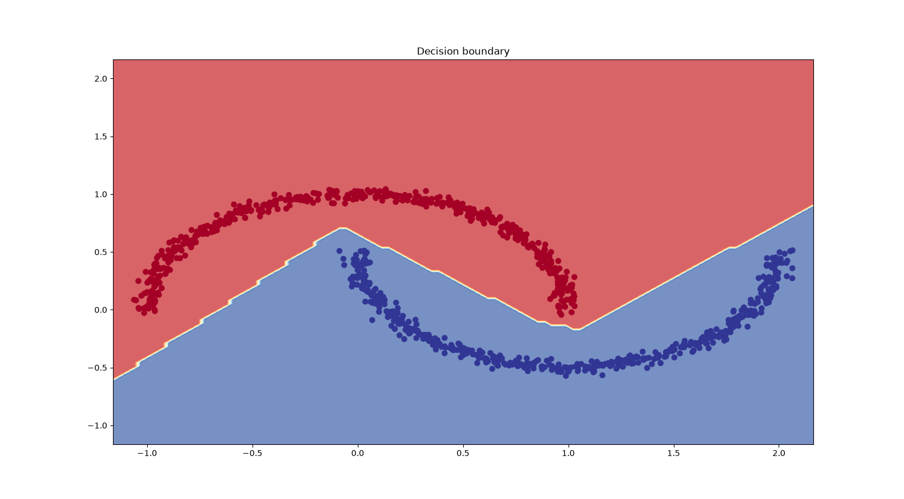
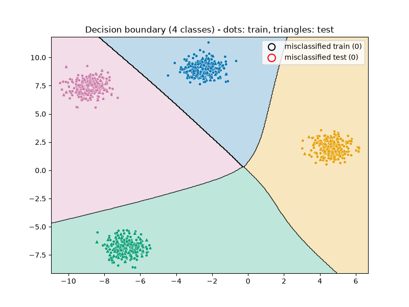
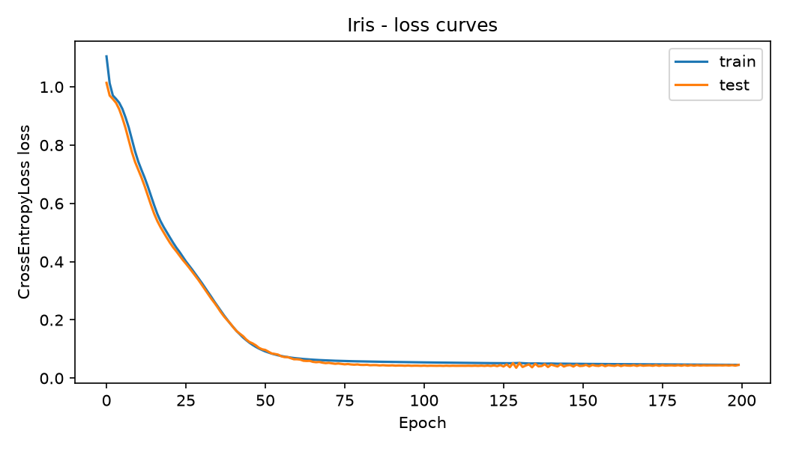
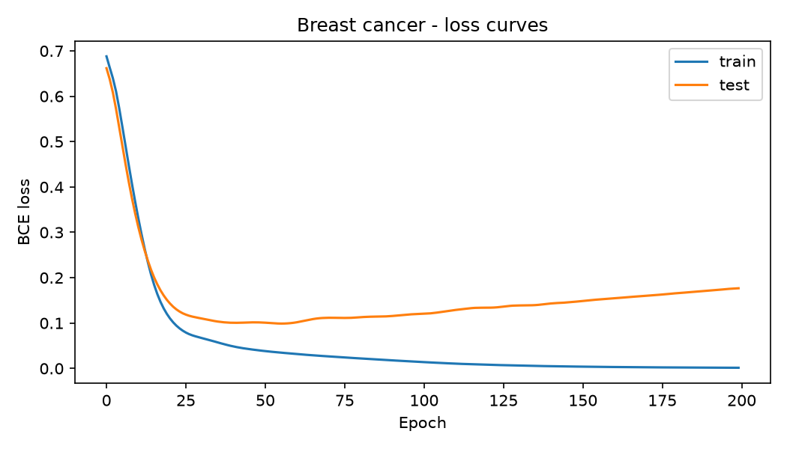

# PyTorch classification: from toy datasets to tabular data

Four small PyTorch MLPs, written while learning the core workflow:
data → model → loss → training loop → evaluation.
These are learning exercises, not a model benchmark.

## Results

| # | Script | Dataset | Classes | Loss | Test accuracy |
|---|---|---|---|---|---|
| 01 | `01_moons_binary.py` | `make_moons` (noise=0.03) | 2 | `BCEWithLogitsLoss` | 100.00 % (200 test samples) |
| 02 | `02_blobs_4_classes.py` | `make_blobs` (std=0.6) | 4 | `CrossEntropyLoss` | 100.00 % (200 test samples) |
| 03 | `03_iris_3_classes.py` | Iris | 3 | `CrossEntropyLoss` | 100.00 % (30 test samples) |
| 04 | `04_breast_cancer_binary.py` | Breast cancer (Wisconsin) | 2 | `BCEWithLogitsLoss` | 95.61 % (114 test samples; LogReg baseline: 98.25 %) |

All models are small MLPs with two hidden layers, trained with Adam (lr=0.01, except lr=0.001 for the blobs script) on an 80/20 train/test split (`random_state=42`).

Scripts 01-03 are saturated and mainly check that the training loop works. Script 04 is the only one where model choice matters, which is why it is the only one with a baseline.

## 01 - Moons (binary)



A ReLU MLP learns a non-linear boundary between the two moons. At this noise level the dataset is almost perfectly separable.

## 02 - Blobs (4 classes)



Dots are training points, triangles are test points. The four clusters are far apart, so the task is easy.

## 03 - Iris (3 classes)



The loss starts near ln(3) ≈ 1.1 (random guessing over 3 classes) and flattens between epochs 60 and 100 with no sign of overfitting. The test set has only 30 samples, so one error moves the accuracy by 3.3 points. Train accuracy is 98.33 %, so 100 % on 30 samples cannot be separated from a lucky split.

## 04 - Breast cancer (binary)



Features are standardized (scaler fitted on the training set only). Confusion matrix on the test set (rows: true class, 0 = malignant):

```
[[41  1]
 [ 4 68]]
```

Malignant recall is 0.98 (1 missed malignant tumour out of 42). The test loss reaches its minimum around epoch 50, then rises while the train loss goes to ~0: the model overfits. A plain logistic regression baseline (98.25 %) beats the MLP (95.61 %), which is expected on a small tabular dataset (569 samples).

## What I learned

- `BCEWithLogitsLoss` (one raw logit, float targets) vs `CrossEntropyLoss` (N logits, integer class indices).
- Feature scaling matters: breast cancer features span several orders of magnitude. Fit the scaler on the training set only.
- Loss curves show overfitting that accuracy hides: test accuracy stayed flat while the test loss kept rising.
- Always compare against a simple baseline before claiming a neural network is the right tool.

## Limitations

- Scripts 01-03 use toy or near-separable datasets: an accuracy close to 100 % says little about model quality.
- Single train/test split, no cross-validation. The Iris test set has only 30 samples.
- Script 04 has no validation split: the reported model is the epoch-200 model, past the test-loss minimum. The proper fix is early stopping on a separate validation set.

## Run

```bash
pip install -r requirements.txt
python 04_breast_cancer_binary.py
```

Plots are saved in `images/`.

## Next

CNNs and torchvision.


